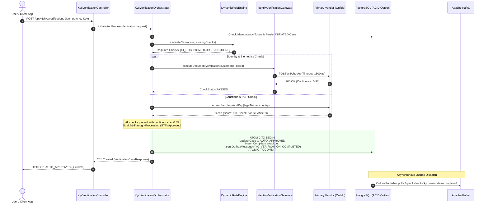
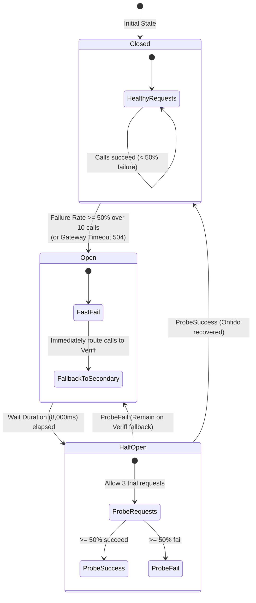

# Wise Global KYC & Onboarding Platform: Architectural Specification

## 1. Executive Summary & Problem Domain

The **Global KYC (Know Your Customer) and Onboarding Platform** is the mission-critical gatekeeper of the Wise ecosystem, responsible for verifying identity, determining regulatory compliance, and managing risk across **160+ countries and 40+ currencies**. 

The platform powers three core engineering squads at Wise:
1. **Personal Onboarding Verification**: Low-friction, high-velocity identity, address, and biometric verification for retail users.
2. **Business Onboarding Verification (KYB)**: Multi-tier corporate entity verification, Companies House/registry corroboration, and Ultimate Beneficial Owner (UBO $\ge 25\%$) tracking.
3. **Wise Platform Verification**: Embedded finance APIs allowing tier-1 banks and neo-brokers (e.g., Monzo, Interactive Brokers) to leverage Wise onboarding rails.

### Core Architectural Mandates
- **Straight-Through Processing (STP)**: Target $> 85\%$ instantaneous verification in $< 500\text{ms}$ with zero human intervention.
- **Extreme Resilience**: 3rd-party vendor outages (Onfido, ComplyAdvantage, Veriff) must never fail customer signups or cause thread starvation.
- **Zero Data Loss Dual-Write Immunity**: State transitions and downstream Kafka event emission are ACID-guaranteed via the Transactional Outbox pattern.
- **Config-Driven Multi-Jurisdiction Agility**: Continuous regulatory shifts (UK FCA, EU AMLD6, US FinCEN, SG MAS) are modeled as dynamic Directed Acyclic Graphs (DAGs) supporting zero-risk **Shadow Mode** canary deployments.

---

## 2. High-Level Architecture Diagram

```mermaid
flowchart TD
    subgraph ClientLayer["Client & Partner Ingress"]
        Web["Wise Web / CRAB Next.js"]
        Mobile["iOS / Android Native Apps"]
        B2B["Wise Platform Banking APIs"]
    end

    Gateway["API Gateway / Envoy Ingress & Rate Limiter"]
    ClientLayer --> Gateway

    subgraph ServiceMesh["Wise Global KYC Service Mesh"]
        Orchestrator["KycVerificationOrchestrator<br/>(Spring Boot 3 / Java 21)"]
        RuleEngine["DynamicRuleEngine<br/>(Jurisdiction DAG & Shadow Evaluator)"]
        ResilienceGw["IdentityVerificationGateway<br/>(Resilience4j Circuit Breaker & Bulkhead)"]
        OutboxWorker["OutboxPublisher<br/>(Scheduled CDC / At-Least-Once Delivery)"]
        AgentTooling["HumanReviewService<br/>(Compliance Officer Review API)"]
    end

    Gateway --> Orchestrator
    Gateway --> AgentTooling

    Orchestrator --> RuleEngine
    Orchestrator --> ResilienceGw

    subgraph DataPersistence["Polyglot Persistence Layer"]
        Postgres[("PostgreSQL 16 Primary<br/>ACID Entities & Outbox Table")]
        RedisCache[("Redis 7 Cluster<br/>Idempotency Tokens & Locks")]
    end

    Orchestrator --> Postgres
    Orchestrator --> RedisCache
    OutboxWorker --> Postgres

    subgraph ExternalVendors["External Identity & Compliance SaaS"]
        PrimaryVendor["Primary Vendor (Onfido)<br/>NFC ID & Biometrics"]
        FallbackVendor["Fallback Vendor (Veriff)<br/>Active Circuit Failover"]
        SanctionsVendor["Sanctions / PEP (ComplyAdvantage)<br/>OFAC / HMT Screening"]
    end

    ResilienceGw -->|Circuit Breaker (Closed)| PrimaryVendor
    ResilienceGw -.->|Failover on Outage (Open)| FallbackVendor
    Orchestrator --> SanctionsVendor

    subgraph StreamingEcosystem["Event Streaming & Downstream Mesh"]
        KafkaBus[["Apache Kafka Broker Cluster<br/>(KRaft Mode)"]]
        Downstream1["Account Activation Service"]
        Downstream2["Debit Card Issuance Service"]
        Downstream3["Compliance Audit Reporting"]
    end

    OutboxWorker -->|Publish Events| KafkaBus
    KafkaBus --> Downstream1
    KafkaBus --> Downstream2
    KafkaBus --> Downstream3
```

---

## 3. End-to-End Straight-Through Processing (STP) Sequence



---

## 4. Resilience4j Circuit Breaker & Multi-Tier Failover Lifecycle

In high-throughput fintech, downstream provider failures are inevitable. The gateway implements a 3-tier failure mitigation strategy:



### Fallback Guarantee
1. **Tier 1 (Normal Operations)**: Primary identity vendor (Onfido) validates documents & biometrics.
2. **Tier 2 (Circuit Tripped / Timeout)**: Resilience4j intercepts failure, executes fallback method, and routes seamlessly to secondary vendor (Veriff). Customer experiences zero disruption.
3. **Tier 3 (Multi-Vendor Outage)**: If both vendors fail, status transitions gracefully to `PENDING_VENDOR` and is queued for background retries. Customer signup does not crash with a 500.

---

## 5. CAP / PACELC Architectural Analysis & Latency Budgets

| Property | Choice | Rationale |
| :--- | :--- | :--- |
| **CAP Theorem** | **CP** (Consistency / Partition Tolerance) | In financial compliance, verifying sanctions and regulatory identity requires strict correctness over dirty reads. A customer cannot be approved based on stale sanctions data. |
| **PACELC Theorem** | **PC/EC** (Partition: Consistency; Else: Consistency) | Under normal operations, write operations prioritize consistency to prevent dual-spend / duplicate onboarding. Reads (status queries) leverage read replicas with eventual consistency ($< 50\text{ms}$ replication lag). |

### Latency Budget (Target: $< 500\text{ms}$ p99)
- Gateway Authentication & Ingress: $15\text{ms}$
- Redis Idempotency Token Acquisition: $2\text{ms}$
- Dynamic Rule DAG Evaluation: $5\text{ms}$
- Parallel External Vendor Calls (Bulkhead Isolated): $380\text{ms}$
- PostgreSQL ACID Commit (Case + Audit + Outbox): $18\text{ms}$
- **Total End-to-End Latency**: $\approx 420\text{ms}$

---

## 6. Zero-Downtime Database Migrations (Expand/Contract Pattern)

Wise runs hundreds of continuous deployments per week. Database schema updates follow the **Expand / Contract (Parallel Run)** pattern:
1. **Expand Phase**: Add new nullable columns or tables (e.g. `aggregate_risk_score`). Existing application code continues functioning uninterrupted.
2. **Dual-Write Phase**: Deploy new application version that writes to both legacy and new structures while reading from legacy.
3. **Backfill Phase**: Asynchronous batch job backfills historical data.
4. **Contract Phase**: Application switches read path to new structures; legacy column is dropped safely in a subsequent release.
