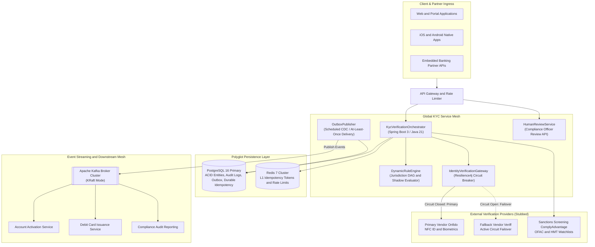
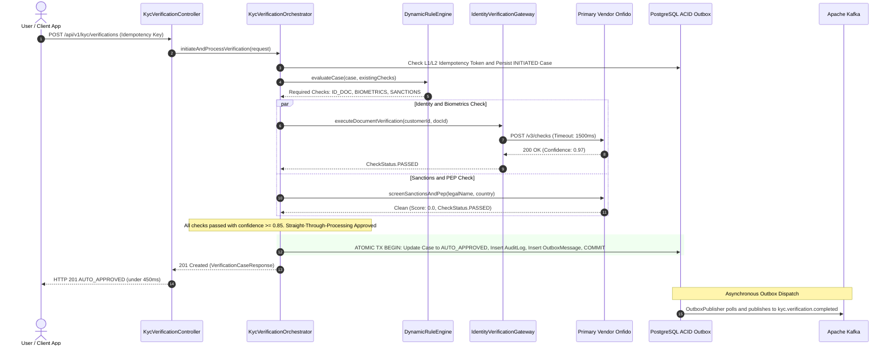
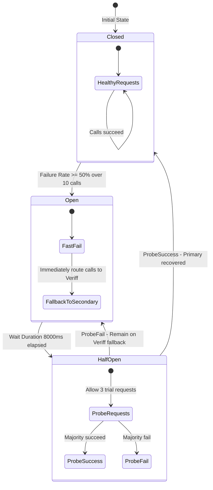

# Global KYC & Onboarding Decision Platform: Architectural Specification

## 1. Problem Domain & Scale Framing

The **Global KYC (Know Your Customer) and Onboarding Platform** is the reference decision engine modeled on international money movement architectures across multiple regulatory regimes (UK FCA, EU AMLD6, US FinCEN, Singapore MAS).

### Scale & Real-World Framing
A global fintech onboarding approximately 500,000 customers per month handles an average steady-state throughput of **~0.2 to 2 transactions per second (TPS)**, with peak marketing surges reaching 30–50 TPS.

Therefore, the primary architectural challenge in Global KYC is **not raw high-throughput streaming**. Rather, the mission-critical engineering challenges center on:
1. **Regulatory Correctness & Determinism**: Verifying customers against shifting legal standards without regressions.
2. **Auditability & Evidentiary Proof**: Maintaining an immutable, tamper-evident chronological log of every rule evaluated, vendor confidence score, and officer decision for FCA/BaFin audits.
3. **Safe Policy Evolution**: Introducing new compliance checks (e.g. enhanced due diligence thresholds) without breaking live signups, verified via **Shadow Mode** before enforcement.
4. **Third-Party Fault Isolation**: Decoupling fragile external SaaS vendors (IDV, biometrics, PEP/sanctions) through circuit breakers and active failovers.
5. **Data Protection & PII Privacy**: Enforcing strict zero-knowledge principles, field-level encryption, and log redaction.

---

## 2. High-Level Architecture Diagram

---

## 3. End-to-End Straight-Through Processing (STP) Sequence

---

## 4. Resilience4j Circuit Breaker & Failover Policy

### Circuit Breaker State Transitions

### The Sanctions Invariant: Fail-Closed
A critical architectural distinction exists between document verification and sanctions screening:
* **Identity Documents (Fail-Over Allowed)**: If Onfido fails, traffic safely fails over to Veriff or queues asynchronously.
* **Sanctions & PEP (Fail-Closed Strictly)**: Sanctions screening **must never fail open**. If the sanctions provider times out, throws a 5xx, or experiences a network partition, the verification check is unconditionally flagged, straight-through approval is withheld, and the case is quarantined for manual review.

---

## 5. Data Protection, PII & Regulatory Auditing

1. **Field-Level Encryption**: Sensitive identifiers (passport numbers, national tax IDs, SSNs) are encrypted at rest using AES-256 before database insertion.
2. **Log Redaction**: Standard log appenders sanitize PII to prevent customer credentials or biometric identifiers from leaking into ELK/Splunk logs.
3. **Immutable Audit Trails**: The `compliance_audit_logs` table records every actor, rule evaluation rationale, and status transition with UTC timestamps for FCA/BaFin regulatory reporting.
4. **Dual-Tier Idempotency**: Redis L1 cache absorbs high-frequency network retries ($< 1\text{ms}$), backed by a durable PostgreSQL unique constraint (`uk_idempotency_key`) to guarantee consistency across cache evictions and node restarts.

---

## 6. Zero-Downtime Database Migrations (Expand/Contract Pattern)

Schema updates follow the **Expand / Contract (Parallel Run)** pattern:
1. **Expand Phase**: Add new nullable columns or tables. Application continues running uninterrupted.
2. **Dual-Write Phase**: Deploy application version writing to both old and new columns.
3. **Backfill Phase**: Asynchronous batch job backfills historical data.
4. **Contract Phase**: Read path switched to new column; legacy column deprecated and dropped in a subsequent release.
