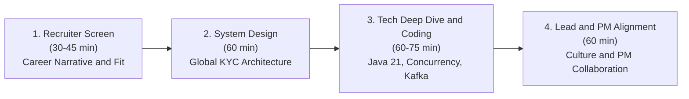

# Senior II / Lead Software Engineer: Global KYC & Onboarding Interview Playbook

This playbook is the comprehensive preparation guide for the **Senior II / Lead Software Engineer - Global KYC and Onboarding** role in tier-1 global fintechs. It links directly to the architectural principles implemented in the [`global-kyc-onboarding-platform`](https://github.com/snehanathani/global-kyc-onboarding-platform) repository.

---

## Part 1: Engineering Culture & Squad Philosophy

Modern high-growth fintechs operate differently from traditional hierarchical banks or top-down enterprises. Understanding these core organizational pillars is mandatory to pass the Lead/Senior II bar:

### 1. Autonomous Squads & Tribes
- Squads are **autonomous, cross-functional mini-startups** (typically 4–8 engineers, 1 Product Manager, 1 Data Analyst, 1 Operations Lead, and embedded Compliance officers).
- The Global KYC & Verification Tribe contains three key squads:
  1. **Personal Onboarding Verification**: Eliminating friction from consumer identity, selfie biometrics, and proof of address.
  2. **Business Onboarding Verification (KYB)**: Solving complex legal structures, company registries, and Ultimate Beneficial Owners (UBOs).
  3. **Platform Embedded Verification**: Exposing APIs for enterprise partners embedding verification onboarding rails.
- **"You build it, you run it"**: The squad owns its microservices from architecture and coding to CI/CD, canary rollouts, alerting, and on-call rotations. There is no separate "Ops" or "DevOps" handover team.

### 2. Core Cultural Values
- **Customer First, Team Second, Ego Last**: Customer impact trumps technical purity. If an architecture is mathematically elegant but drops customer conversion by 3%, it is the wrong architecture.
- **Context over Control**: Leads do not dictate; they provide context, align roadmaps with product strategy, and empower squad members to make local decisions.
- **Radical Transparency**: Post-mortems are blameless; metrics (STP rate, drop-off rates, vendor latencies) are publicly visible across the company.

---

## Part 2: The 4-Stage Interview Breakdown

---

## Part 3: System Design Deep Dive (Stage 2)

### The Classic Prompt
> *"Design a high-throughput, multi-jurisdiction KYC verification and document processing engine that handles 1 million monthly verifications across 160 countries, integrates with multiple third-party identity and sanctions vendors, guarantees zero data loss, and delivers automated decisions in under 500ms."*

### How to Structure Your Response as an Architect / Lead:

#### Step 1: Clarify Scope & Non-Functional Requirements (5 minutes)
- **Functional**:
  - Individual and Business (KYB) onboarding flows.
  - Integration with identity vendors (Onfido, Veriff), sanctions lists (OFAC, UK HMT), and corporate registries (Companies House).
  - Straight-Through-Processing (STP) for instant approval; operational queue for human review.
- **Non-Functional / Scale**:
  - **Throughput**: $1\text{M verifications / month} \approx 0.4\text{ requests / sec average}$, with peak surges up to $50\text{ requests / sec}$.
  - **Latency SLA**: p99 $< 500\text{ms}$ for straight-through approval.
  - **Availability**: $99.99\%$ availability ($< 52\text{ minutes downtime / year}$).
  - **Consistency**: Strict consistency for customer state and compliance audits (CP under CAP); zero event loss.

#### Step 2: High-Level Bounded Contexts & Services (10 minutes)
Decompose into domain-driven microservices:
1. **Onboarding Gateway & Orchestrator**: Receives API requests, validates inputs, coordinates workflow.
2. **Dynamic Compliance Rules Engine**: Evaluates country-specific requirements as a Directed Acyclic Graph (DAG) (e.g. UK FCA vs EU AMLD6).
3. **Vendor Gateway with Circuit Breakers**: Isolates 3rd-party SaaS providers using Resilience4j (Bulkhead, TimeLimiter, CircuitBreaker).
4. **Human Review & Ops Tooling API**: Websocket/REST queue for compliance officers to inspect flagged cases.
5. **Event Streaming Bus (Apache Kafka)**: Distributes downstream domain events (`kyc.verification.completed`, `kyc.agent.review_required`).

#### Step 3: Deep Dive into Critical Architectural Trade-Offs (25 minutes)

##### Trade-Off 1: How do you prevent lost events between your Database and Kafka?
- **Answer**: The **Transactional Outbox Pattern** (see [`docs/adr/ADR-001`](docs/adr/ADR-001-transactional-outbox-vs-2pc.md)).
  - Explain why 2PC/XA transactions across Postgres and Kafka are anti-patterns in cloud-native microservices (high coordinator latency, blocking locks).
  - Describe saving the entity state mutation and the outbox event in the same Postgres local ACID transaction.
  - Explain the Debezium CDC or scheduled outbox publisher that pushes to Kafka with at-least-once delivery, combined with Redis/DB idempotency keys on consumers.

##### Trade-Off 2: How do you handle 3rd-party vendor latency and outages?
- **Answer**: **Multi-Tier Fault Isolation with Resilience4j** (see [`docs/adr/ADR-003`](docs/adr/ADR-003-resilience4j-circuit-breaker-multi-tier-failover.md)).
  - Bulkheads isolate thread pools so a hanging Onfido call cannot exhaust the Tomcat request thread pool.
  - Circuit Breakers trip from `CLOSED` to `OPEN` when error rates exceed 50%.
  - Active failover to secondary provider (Veriff) ensures the user signup succeeds without degradation.
  - Catastrophic double-vendor outages degrade gracefully to asynchronous background queueing (`PENDING_VENDOR`), never 500 Internal Server Errors.

##### Trade-Off 3: How do you support changing compliance regulations without constant code redeployment?
- **Answer**: **Config-Driven Dynamic Rule DAG** (see [`docs/adr/ADR-002`](docs/adr/ADR-002-dynamic-rule-dag-vs-hardcoded-fsm.md)).
  - Rules are declarative components with priority scoring.
  - Introduce **Shadow Mode Execution**: When compliance officers want to test a new sanction screening threshold or address check, the rule evaluates silently in the background on live traffic, logging metric divergences without blocking real users. Once vetted, it is promoted to production.

---

## Part 4: Technical Deep Dive & Coding Scenarios (Stage 3)

### Q1: "Explain how you handle race conditions when two compliance officers attempt to claim or review the same KYC case simultaneously."
- **Model Answer**:
  - We use **Optimistic Locking** via JPA's `@Version` column in PostgreSQL.
  - When Agent A and Agent B fetch Case #101 at `version = 3`, both see it unassigned.
  - If Agent A claims it first, the SQL statement executes: `UPDATE verification_cases SET assigned_agent_id = 'agent_A', version = 4 WHERE id = 101 AND version = 3`.
  - When Agent B submits their claim, the row's version is now 4. The update affects 0 rows, triggering an `OptimisticLockingFailureException`.
  - The API returns HTTP 409 Conflict: *"This case has already been assigned to Agent A."* This avoids heavy pessimistic database row locks (`SELECT FOR UPDATE`) and maintains maximum throughput.

### Q2: "How do you guarantee exactly-once processing in Kafka event consumers?"
- **Model Answer**:
  - True end-to-end exactly-once in distributed networks across heterogeneous systems is fundamentally impossible without idempotency.
  - While Kafka provides transactional producers (`enable.idempotence=true`), downstream sinks (e.g. activating multi-currency account balances) require **Idempotent Consumers**.
  - Every message carries a unique business idempotency key (e.g. `caseId + status`).
  - The consumer uses an atomic Redis `SET key value NX EX 86400` (or a PostgreSQL unique constraint table `processed_events`) before applying business logic. If the key already exists, the event is acknowledged and safely ignored.

### Q3: "Walk me through how you size and tune a Resilience4j Circuit Breaker for high-traffic financial APIs."
- **Model Answer**:
  - `slidingWindowType`: Use `COUNT_BASED` for stable traffic; `TIME_BASED` if traffic is bursty.
  - `slidingWindowSize`: 10–20 calls per host instance. Sizing too large delays failure detection; sizing too small causes flapping on single transient errors.
  - `failureRateThreshold`: 50%.
  - `slowCallRateThreshold` and `slowCallDurationThreshold`: e.g. 50% calls taking $> 2000\text{ms}$ are treated as failures to prevent latency cascading.
  - `waitDurationInOpenState`: 8–10 seconds.
  - `permittedNumberOfCallsInHalfOpenState`: 3 probe requests to test whether the upstream vendor has genuinely recovered.

---

## Part 5: Working with Product Managers & Cross-Functional Alignment (Stage 4)

In the Lead interview, you will be rigorously tested on how you collaborate with Product Managers, Compliance Officers, and Operations Leads.

### Framework 1: Managing the Tension Between Conversion vs Compliance
- **The Dilemma**: Product Managers want maximum conversion (zero onboarding steps, instant account creation). Compliance Officers want zero regulatory risk (collect passport, selfie, utility bill, proof of wealth for everyone).
- **The Lead Engineer's Role**:
  - *Data-driven Risk Tiering*: Do not treat all corridors or users identically. A user sending £50 to a family member in Europe should have low-friction Straight-Through-Processing (STP). A user sending £50,000 to a high-risk jurisdiction triggers Enhanced Due Diligence (EDD).
  - *Measuring Friction with Telemetry*: Quantify drop-off rates at each step. Show the PM and Compliance Lead the exact conversion impact: *"Requiring proof of address for transactions under £5k causes an 18% signup abandonment rate, while historical fraud rate in this cohort is only 0.002%."*
  - *Canary & Shadow Mode Testing*: Test stricter compliance rules silently before enforcing them.

### Framework 2: Translating Vague Regulatory Directives into Technical Milestones
- **Scenario**: Regulators issue a directive: *"Firms must implement enhanced monitoring for high-risk cross-border corridors within 90 days."*
- **Step-by-Step Approach**:
  1. **Joint Discovery with Compliance & Legal**: Translate vague prose into measurable business rules: What defines "high-risk"? What specific data attributes are required?
  2. **Decompose into an RFC / Architectural Decision Record (ADR)**: Document schema migrations, external vendor API changes, and fallback mechanisms.
  3. **Phase 1: Instrumentation & Shadow Mode (Weeks 1–4)**: Deploy updated rule evaluation to shadow mode. Log which customers would have been blocked without impacting live transactions.
  4. **Phase 2: Ops Tooling & Capacity Preparation (Weeks 5–8)**: Review false-positive rates with the Compliance Squad. Ensure human review queues have sufficient staffing.
  5. **Phase 3: Progressive Rollout (Weeks 9–12)**: Enable the rule on 5% of traffic using feature flags, monitor conversion and error rates, then expand to 100%.

### Framework 3: Handling Technical Debt vs Product Features
- **The Dilemma**: The PM wants to launch personal onboarding in a new Latin American corridor next month, but the KYC service's database schema is monolithic and connection pooling is near exhaustion.
- **How to Lead**:
  - Never frame refactoring as an abstract engineering indulgence. Frame technical debt in **business and product terms**:
    - *"If we launch Latin America on our current database architecture, our connection limits will saturate during Black Friday peak, bringing down European onboarding as well. That represents £1.2M in daily volume at risk."*
  - Propose an incremental architecture plan: Instead of stopping feature work for 6 months, allocate 20–25% of each sprint to decoupling the database using the Expand/Contract pattern while building the new corridor integration in parallel.
