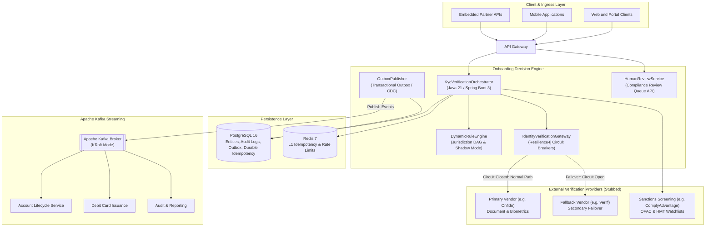

# Global KYC & Onboarding Platform (Reference Implementation)

[](https://adoptium.net)
[](https://spring.io/projects/spring-boot)
[](https://resilience4j.readme.io/)
[](https://kafka.apache.org/)
[](https://www.postgresql.org/)
[](LICENSE)

A reference implementation exploring config-driven KYC onboarding, transactional outbox messaging, and circuit-breaker resilience in Java 21 and Spring Boot 3. Downstream identity and sanctions vendors (such as Onfido, Veriff, and ComplyAdvantage) are stubbed to model real-world failure modes, latency, and failovers.

---

## Technical Context & Scope

In international money movement, onboarding systems handle complex trade-offs between regulatory compliance and user friction across multiple jurisdictions (UK FCA, EU AMLD6, US FinCEN, Singapore MAS). While overall monthly sign-up volumes may translate to modest average request rates (~0.2 to 2 requests per second), the engineering challenges center on:

1. **Auditability & Regulatory Correctness**: Ensuring every onboarding decision is backed by an immutable chronological trail of rules evaluated, vendor responses, and compliance justifications.
2. **Safe Rule Evolution**: Allowing compliance teams to adjust thresholds and corridors dynamically without requiring monolithic code deployments, evaluated safely in shadow mode before general activation.
3. **Fault Isolation**: Handling 3rd-party SaaS latency spikes or regional outages without stranding user signup sessions.
4. **Data Consistency**: Eliminating dual-write inconsistencies between relational database state and downstream event streaming topics.

---

## Core Components



### Key Architectural Patterns
* **Config-Driven Dynamic Rule DAG**: Compliance rules are decoupled into standalone components with priority ordering and jurisdictional filters. Supports **Shadow Mode** execution to evaluate rule modifications against live traffic without altering production decisions.
* **Resilience4j Circuit Breakers & Failover**: Wraps external vendor calls with `@CircuitBreaker`, `@Bulkhead`, and `@Retry`. When the primary identity provider errors or times out, the gateway fails over to a secondary provider or degrades to an asynchronous review state.
* **Fail-Closed Sanctions Invariant**: Unlike identity document checks where secondary vendor failover is permitted, sanctions screening strictly fails closed. Any vendor failure or watch-list ambiguity halts automated approval and routes to compliance officers.
* **Transactional Outbox Pattern**: Case updates and event payloads are committed within the same database transaction. An asynchronous worker polls the outbox and publishes events to Apache Kafka with guaranteed at-least-once delivery.
* **Durable Idempotency**: Dual-layer idempotency utilizing an in-memory cache (Redis) for low-latency fast checks backed by a unique database constraint in PostgreSQL to guarantee durability across cache evictions or node restarts.

---

## Technology Stack

* **Language**: Java 21 (LTS)
* **Framework**: Spring Boot 3.3.4 (Spring Data JPA, Spring Web, Spring Kafka, Actuator)
* **Fault Tolerance**: Resilience4j 2.2.0 (CircuitBreaker, Bulkhead, Retry)
* **Messaging**: Apache Kafka 3.7 (KRaft)
* **Primary Database**: PostgreSQL 16 (H2 utilized for zero-dependency local testing)
* **Distributed Cache**: Redis 7
* **Observability**: Micrometer, Prometheus metrics

---

## Local Development & Testing

### Prerequisites
* Java 21 (`java -version`)
* Maven 3.9+ (Included via `./mvnw`)

### Running the Test Suite
The repository includes automated unit and integration tests covering multi-jurisdiction rule evaluation, simulated vendor outages, circuit breaker failovers, sanctions match quarantine, and dual-layer idempotency:

```bash
./mvnw clean test
```

### Running Locally in Standalone Mode
The application boots by default with an embedded H2 database and in-memory fallbacks, requiring no external infrastructure to inspect:

```bash
./mvnw spring-boot:run
```

The application starts on `http://localhost:8080`.

---

## Architectural Decision Records (ADRs)

Detailed trade-offs and rationale behind key architectural decisions:
* [ADR-001: Transactional Outbox vs Two-Phase Commit](docs/adr/ADR-001-transactional-outbox-vs-2pc.md)
* [ADR-002: Dynamic Rule DAG vs Hardcoded State Machines](docs/adr/ADR-002-dynamic-rule-dag-vs-hardcoded-fsm.md)
* [ADR-003: Multi-tier Resilience & Vendor Failover Strategy with Resilience4j](docs/adr/ADR-003-resilience4j-circuit-breaker-multi-tier-failover.md)
* [ADR-004: Dual-Tier Idempotency: PostgreSQL and Redis](docs/adr/ADR-004-polyglot-persistence-postgresql-redis.md)
* [ADR-005: Straight-Through Processing vs Human Triage](docs/adr/ADR-005-straight-through-processing-and-human-triage.md)
* [ADR-006: ML Scoring with Deterministic Safe Fallbacks](docs/adr/ADR-006-ml-scoring-with-deterministic-fallbacks.md)

---

## License
MIT
